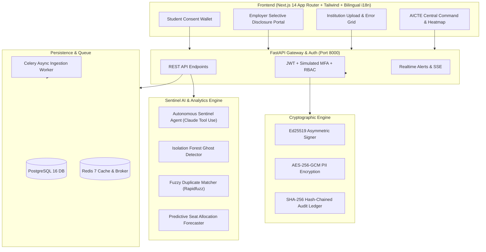

# SATYA-APAAR (सत्य-अपार)
### AICTE APAAR ID-Based Student Data Management & Verification Platform
**Smart India Hackathon • Problem Statement 26263**

---

## 🌟 Executive Overview
Currently, AICTE only receives aggregate enrolment figures from affiliated institutions, creating vulnerabilities to:
- **Ghost Students & Phantom Enrolments**: Artificial inflation of student numbers to justify faculty sanctions and grant claims.
- **Cross-College Dual Enrolments**: Active student records concurrently registered across multiple state and central institutions.
- **Sanctioned Intake Breaches**: Colleges enrolling past their approved capacity without authorized supernumerary justifications.
- **Fraudulent Credentials**: Lack of cryptographically verifiable offline claims for employers and universities.

**SATYA-APAAR** solves this through a unified pipeline:
```
Institution -> Bulk Upload / API -> APAAR Validation -> Real-time Verification -> AICTE Central Repository -> Live Analytics & Sentinel Monitoring -> Selective Disclosure Verification
```

---

## 🏛️ System Architecture



---

## 👥 Role-Based Access Control (RBAC)

The platform enforces strict role-based authorization across 6 distinct personas:

| Role | Default Demo Account | Password | Scope & Privileges |
| :--- | :--- | :--- | :--- |
| **AICTE Admin** | `admin@aicte.gov.in` | `Password@123` | National oversight, state heatmap, audit integrity verification, Sentinel AI supervisor |
| **Regional Officer** | `ro.delhi@aicte.gov.in` | `Password@123` | Northern regional seat monitoring, clash case escalation, inspection approvals |
| **Institution Admin** | `admin@iitd.ac.in` | `Password@123` | Bulk CSV/Excel student ingestion, error correction grid, 90% seat warning & 100% seat lock |
| **University / Regulator** | `regulator@aktu.ac.in` | `Password@123` | Affiliation seat monitoring, dual enrolment clash tracking across university network |
| **Employer Verifier** | `tcs.verifier@tcs.com` | `Password@123` | Selective disclosure verification, Ed25519 offline signed QR certificate check |
| **Student (APAAR Holder)** | `aarav.sharma@satya.gov.in` | `Password@123` | DPDP 2023 Consent Wallet: field-level permissions, view access history, signed credential download |

---

## 🔐 Cryptography & DPDP Act 2023 Compliance
1. **Ed25519 Verifiable Credentials**:
   - Issued credentials contain canonical JSON claims signed with AICTE's master private key.
   - Any employer or university can verify authenticity offline without contacting AICTE servers.
2. **AES-256-GCM PII Encryption**:
   - Student Name, Date of Birth, and Aadhaar-linked markers are encrypted at rest with fresh 12-byte initialization nonces.
3. **SHA-256 Hash-Chained Audit Trail**:
   - Every single sensitive action (upload, review, case creation, authentication, consent update) is committed to an append-only cryptographic ledger.
   - Each block links monotonically to its parent block hash:
     $$\text{Current Hash} = \text{SHA256}(\text{Sequence} \parallel \text{Timestamp} \parallel \text{User} \parallel \text{Action} \parallel \text{PayloadHash} \parallel \text{PreviousHash})$$
   - Real-time tamper detection instantly identifies any altered historical records.

---

## 🚀 Quick Start Instructions

### Option 1: One-Command Docker Compose (Recommended)
```bash
# Start Postgres, Redis, Backend, Celery, and Frontend simultaneously
docker compose up --build
```
- **Frontend**: [http://localhost:3000](http://localhost:3000)
- **Backend Swagger Docs**: [http://localhost:8000/docs](http://localhost:8000/docs)
- **Backend Health Check**: [http://localhost:8000/api/v1/health/](http://localhost:8000/api/v1/health/)

### Option 2: Standalone Local Windows/Linux Execution
1. **Seed the database** (Runs with SQLite fallback or local PostgreSQL):
   ```cmd
   run_seed.bat
   ```
2. **Start Backend**:
   ```cmd
   run_backend.bat
   ```
3. **Start Frontend**:
   ```cmd
   run_frontend.bat
   ```

---

## 📊 Planted Synthetic Test Data Summary
- **Institutions**: 40 premier institutions across Delhi, Maharashtra, Karnataka, Tamil Nadu, Uttar Pradesh, Haryana, Telangana, Gujarat, Punjab, Rajasthan, etc.
- **Students**: 5,000 synthetic records with realistic names, valid 12-digit APAAR IDs, categories, quotas, and document hashes.
- **Planted Anomalies for Demo**:
  1. **Cross-College Dual Enrolment Clash**: Student `Rohan Verma` (APAAR `992817263541`) concurrently active at IIT Delhi and AKTU Lucknow.
  2. **Intake Breach**: Apex Institute of Advanced Technology (Rohtak) enrolled 138 students against 120 sanctioned seats (115% intake breach).
  3. **Ghost Student Cluster**: Shri Balaji Institute (Sonipat) with 85% admissions clustered on the last 48 hours and unnatural category uniformity.
  4. **Invalid APAAR IDs**: 4 corrupt records failing Verhoeff checksum algorithm and 12-digit formatting checks.
